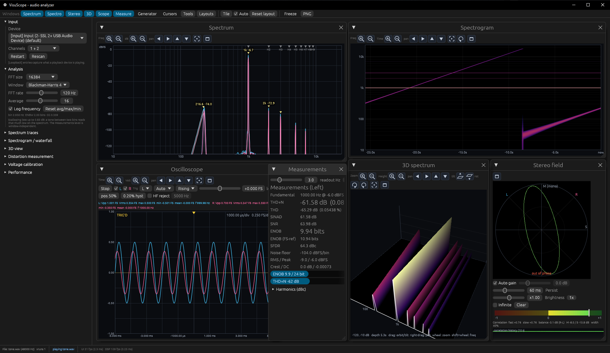
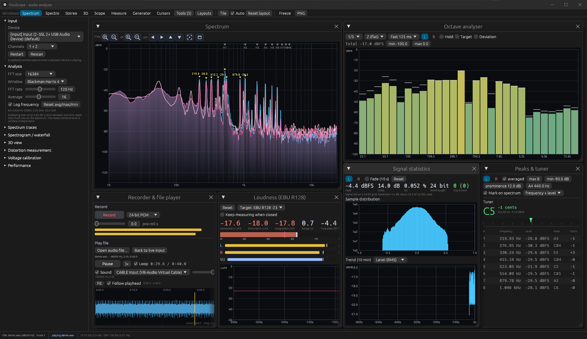
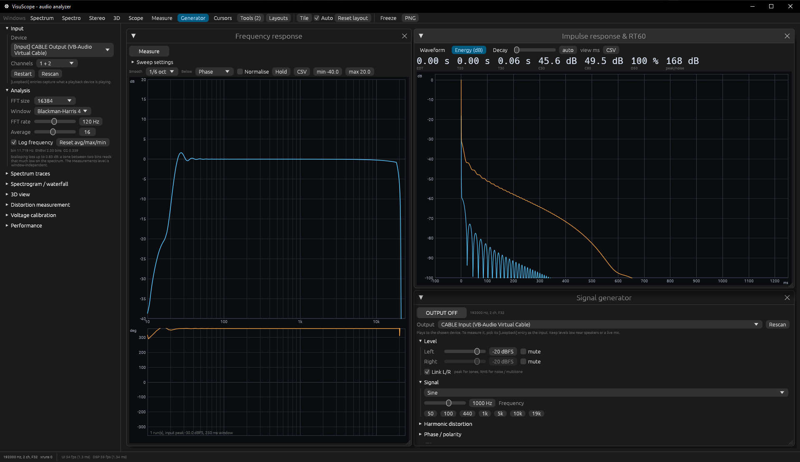
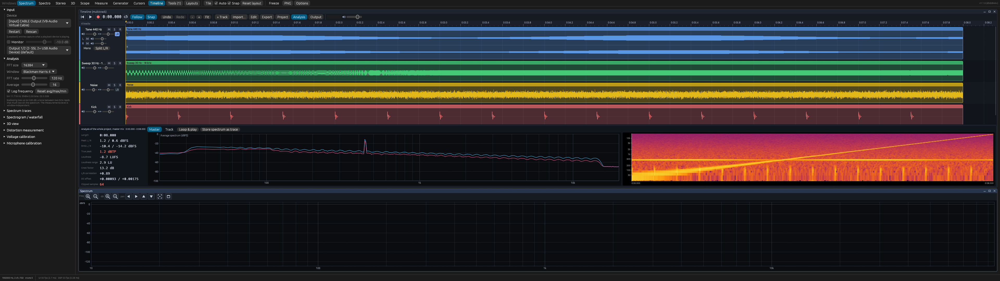
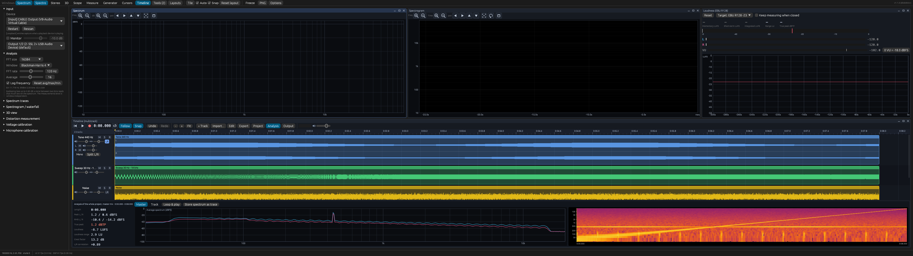
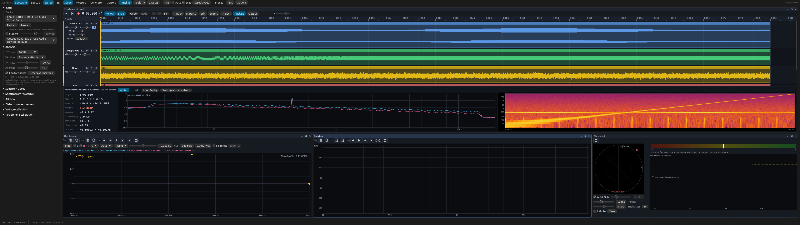
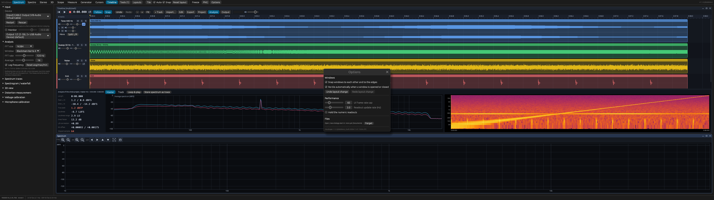

# VisuScope

Real-time audio analyzer for Windows. Captures from an input device or from WASAPI loopback and shows spectrum, spectrogram, 3D spectrum, stereo field and oscilloscope, with distortion measurements and a signal generator.

> **This is not REW (Room EQ Wizard).** It is not intended to be or replace it and has no affiliation with it.



## Features

**Input**
- Microphone, line input, or loopback of any playback device
- Any device channel as L and R, with a level meter per channel
- Microphone calibration files (0 / 90 degrees, e.g. UMIK-1) correct the spectrum views
- Reconnects when the device format changes
- Plays and analyzes audio files (WAV, FLAC, MP3, Ogg Vorbis, AAC/M4A, ALAC, MKV) with optional sound output
- Records to WAV (16/24 bit, 32 bit float) with pre-roll

**Views**
- Spectrum: FFT 1024 to 262144, many window functions, live/average/max/min traces, cursors, snapshots, CSV export
- Spectrogram and waterfall
- 3D spectrum
- Stereo field: goniometer, correlation, balance, mid/side, correlation per frequency
- Oscilloscope: auto, normal, single and roll trigger, HF reject, adjustable trigger position and level
- Octave analyzer, 1/1 to 1/24, A/C weighting, target curve



**Measurements**
- THD, THD+N, SNR, SINAD, SFDR, ENOB, independent of the display window
- Voltage calibration (dBFS, dBV, dBu)
- Frequency response by sweep: magnitude, phase, group delay, coherence
- Impulse response with RT60, EDT, C50, C80, D50
- Loudness (EBU R128), true peak, PPM, VU
- Live transfer function: magnitude, phase and coherence between a reference and a measured channel while music or noise plays, with automatic delay compensation
- Sound level meter: A/C/Z, Fast/Slow/Impulse, Leq, Lmax, peak, L10/L50/L90, calibrator or specification calibration
- Distortion sweeps: THD / THD+N vs frequency and level, IMD (SMPTE, CCIF) vs level, harmonics 2 to 6 from one sweep (Farina)
- Room acoustics: RT60 / EDT / clarity per octave band, waterfall (CSD), STI and %ALcons, room modes with theoretical axial modes
- Peak list with note names, tuner
- Signal statistics: histogram, clipping, bit depth use, trends
- Reference curves and limit masks with pass/fail
- CSV logger with threshold alarms



**Generator**
- Sine, square, triangle, saw, pulse, impulse, sweeps, multitone, SMPTE and CCIF IMD
- White, pink, brown, blue and violet noise
- Harmonics, phase, jitter, bit depth with dither

**Automation and output**
- Test sequences: a small script drives the generator, measures, sweeps and checks limits (pass/fail); `visuscope --run test.vss --report result.txt` runs it from the command line (exit code 0 pass, 1 fail, 2 error)
- Measurement report as HTML (print to PDF), response export as FRD / REW text, impulse response as WAV
- EQ design: parametric filters fitted to a measurement, exported as Equalizer APO text, biquads or a linear / minimum phase FIR

**Interface**
- Stored traces: name, recolour, overlay, show relative to one trace, average, save and load
- Fractional-octave smoothing of the spectrum
- Desktop-style windows with thin title bars: they snap to each other and to the edges, dock to halves / quarters when released against an edge, and neighbours that touch follow when an edge is resized (Alt: resize one window only, Ctrl: move without snapping)
- 24 layout presets (analysis, timeline / studio, acoustics ...), saved layouts (Ctrl+1 to 9), auto tiling, pop-out windows; windows follow when the side bar or the application window is resized
- Undo / redo for layout changes (Ctrl+Alt+Z / Ctrl+Alt+Y), separate from the timeline's own undo
- Options dialog for frame rate, readout rate, window behaviour and the remembered dialog folder
- The version is shown in the title bar and at the right end of the top bar

**Timeline (multitrack recorder and editor)**
- Record several tracks at once from several devices: any channel, stereo pair or mono mix of any input (or loopback) per track, e.g. track 1 = device A left, track 2 = device A right, track 3 = device B mono mix
- Load audio files (also multichannel, drag and drop) as tracks; sample rates are converted
- Non-destructive editing: split, trim, move across tracks, fades, gain, normalize, reverse, duplicate, copy / paste, range delete, undo / redo, snapping
- Stereo tracks can show their left and right channel as sub-tracks (`LR` button) with their own mute and gain; right-click a track to convert it to mono or split it into a left and a right track (panned hard left / right)
- Right-click a track or an empty lane to import a file onto that track or to choose the input it records from
- Mouse wheel zooms, Shift+wheel pans, Alt+wheel (or the wheel over the headers) scrolls the tracks; double-click a slider to type a value, right-click resets it
- Playback leaves the live input in the analysers by default. Turn on *Output > Show the timeline in the analysers* (or press *Loop & play*) to let spectrum, scope, loudness ... follow the master or the selected track
- Analysis of the selection: levels, LUFS, true peak, clipping, spectrum and spectrogram; store the spectrum as a trace
- Mixdown, stems and bounce; projects are saved as `.vsproj` and restored automatically
- Settings are remembered between runs
- PNG screenshots

## Screenshots of the new workflow

**Timeline.** Tracks with waveforms, per-track volume and pan (icons in front of the sliders), the stereo track at the top expanded into its left and right channel, and the analysis of the whole mix (levels, loudness, averaged spectrum, spectrogram) underneath.



**Studio layout.** A built-in layout preset: the timeline on the bottom half with spectrum, spectrogram and loudness above it. The windows snap to each other and can be rearranged freely; there are 24 presets in the Layouts menu and Ctrl+Alt+Z / Ctrl+Alt+Y undo and redo changes of the arrangement.



**Record and monitor.** The timeline with scope, spectrum and stereo field below. Armed tracks show their input level while the analysers keep following the live input; recording from several devices or channels at the same time is set up per track (right-click a track, *Record input*).



**Options.** Settings that are not needed while measuring live in one dialog (top bar, *Options*): window snapping and auto tiling, layout undo / redo, frame rate cap, readout rate and the folder the open / save dialogs start in (it is remembered between runs).



## Download

Prebuilt Windows builds are on the [Releases](../../releases) page.

## Build

Needs Rust 1.85 or newer.

```
cargo build --release
```

The executable is `target/release/visuscope.exe`. Only tested on Windows.

Settings and logs are stored in `%APPDATA%\visuscope`. Recordings and CSV logs go to `Documents\VisuScope`.

## License

[Unlicense](LICENSE), public domain.

This project was made using AI.
