# VisuScope

Real-time audio analyzer for Windows. Captures from an input device or from WASAPI loopback and shows spectrum, spectrogram, 3D spectrum, stereo field and oscilloscope, with distortion measurements and a signal generator.

> **This is not REW (Room EQ Wizard).** It is not intended to be or replace it and has no affiliation with it.

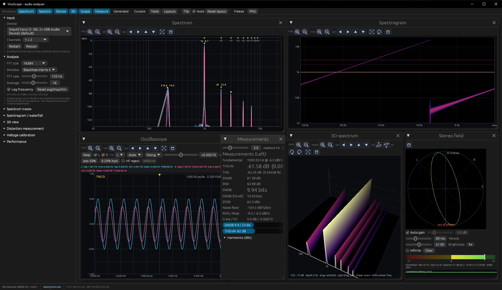

## Features

**Input**
- Microphone, line input, or loopback of any playback device
- Any device channel as L and R, with a level meter per channel
- Microphone calibration files (0 / 90 degrees, e.g. UMIK-1) correct the spectrum views
- Reconnects when the device format changes
- Damaged or unusual files (corrupt audio, project, routing or settings files, odd file names, absurd headers) give an error message instead of a crash
- Audio files (WAV, FLAC, MP3, Ogg Vorbis, AAC/M4A, ALAC, MKV) and recording are handled by the Timeline: load, play and analyse them there, record any input to WAV (float)

**Views**
- Spectrum: FFT 1024 to 262144, many window functions, live/average/max/min traces, cursors, snapshots, CSV export
- Spectrogram and waterfall; the spectrogram can show the *difference* of the two channels (orange: left louder, blue: right louder), which makes a before / after of two signals visible
- *Listen A-B* (corner of the spectrum): hear only the band between cursor A and cursor B, through the monitor or the output nodes of the routing graph
- 3D spectrum
- Stereo field: goniometer, correlation, balance, mid/side, correlation per frequency
- Oscilloscope: auto, normal, single and roll trigger, HF reject, adjustable trigger position and level
- Octave analyzer, 1/1 to 1/24, A/C weighting, target curve

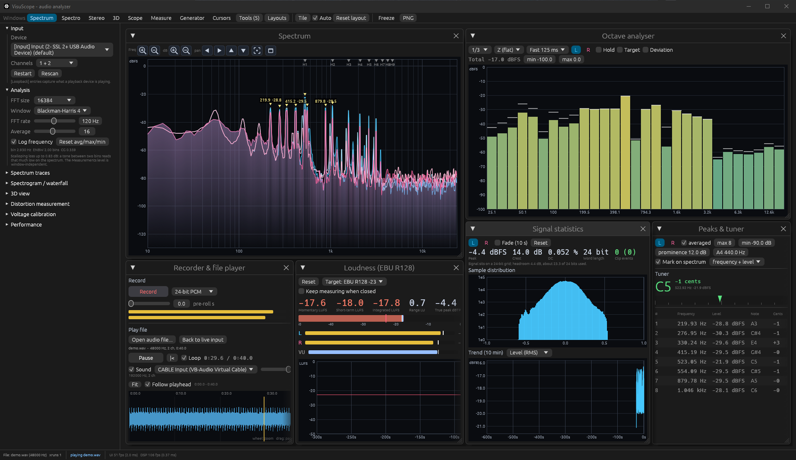

**Measurements**
- THD, THD+N, SNR, SINAD, SFDR, ENOB, independent of the display window
- Voltage calibration (dBFS, dBV, dBu)
- Frequency response by sweep: magnitude, phase, group delay, coherence
- Impulse response with RT60, EDT, C50, C80, D50
- Loudness (EBU R128), true peak, PPM, VU
- Live transfer function: magnitude, phase and coherence between a reference and a measured channel while music or noise plays, with automatic delay compensation
- Sound level meter: A/C/Z, Fast/Slow/Impulse, Leq, Lmax, peak, L10/L50/L90, calibrator or specification calibration
- Distortion sweeps: THD / THD+N vs frequency and level, IMD (SMPTE, CCIF) vs level, harmonics 2 to 6 from one sweep (Farina)
- Room acoustics: RT60 / EDT / clarity per octave band, waterfall (CSD), STI and %ALcons, room modes with theoretical axial modes
- Null test: two signals (input channels or files) are lined up automatically (delay to a fraction of a sample, polarity, level) and subtracted; the residual is shown on a scope and a spectrum next to the originals, the null depth is read out in dB, and A, B or the difference can be played (with a boost for small errors) on the chosen output, or on the first output node while the routing graph is on
- Peak list with note names, tuner
- Signal statistics: histogram, clipping, bit depth use, trends
- Reference curves and limit masks with pass/fail
- CSV logger with threshold alarms

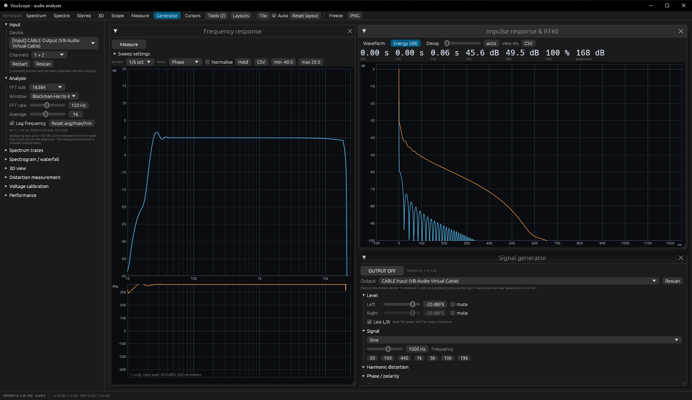

**Generator**
- Sine, square, triangle, saw, pulse, impulse, sweeps, multitone, SMPTE and CCIF IMD
- White, pink, brown, blue and violet noise
- Harmonics, phase, jitter, bit depth with dither

**Automation and output**
- Test sequences: a small script drives the generator, measures, sweeps and checks limits (pass/fail); `visuscope --run test.vss --report result.txt` runs it from the command line (exit code 0 pass, 1 fail, 2 error)
- Measurement report as HTML (print to PDF), response export as FRD / REW text, impulse response as WAV
- EQ design: parametric filters fitted to a measurement, exported as Equalizer APO text, biquads or a linear / minimum phase FIR; with the routing graph on, *Send to routing* puts the filters into an equaliser node (the selected one, the first one, or a new one in front of the output) so the correction can be heard and measured again

**Interface**
- Optional routing graph: all inputs, outputs and effects as nodes in one window (see below), with several generators, a profiler for audio hiccups and layout previews
- Stored traces: name, recolour, overlay, show relative to one trace, average, save and load
- Fractional-octave smoothing of the spectrum
- Desktop-style windows with thin title bars: they snap to each other and to the edges, dock to halves / quarters when released against an edge, and neighbours that touch follow when an edge is resized (Alt: resize one window only, Ctrl: move without snapping)
- 24 layout presets (analysis, timeline / studio, acoustics ...), saved layouts (Ctrl+1 to 9), auto tiling, pop-out windows; windows follow when the application window is resized
- Undo / redo for layout changes (Ctrl+Alt+Z / Ctrl+Alt+Y), separate from the timeline's own undo
- **Assistant** (button at the right end of the top bar): type what you want in plain words, e.g. "measure the frequency, impulse response and distortion with a sweep on input mic1", "THD vs level on the line input", "room acoustics with a sweep from 50 hz to 16 khz", "generate a 1 khz tone at -20 db and monitor it". It shows its plan first (and *Walk me through* asks for the input and channels, the output, a microphone calibration file or none, and the parameters step by step before setting up the windows; each task also suggests a routing patch that can be put into the node editor) (input device and channel, sweep range / length / level / averages, which windows to open and tile, generator and monitor settings) and then sets it up, optionally starting the measurements one after the other. It works offline with keywords and numbers; no service is involved
- No side bar: the input device, its channels and the monitor are in the **Input** menu at the left end of the top bar (the routing graph takes them over when on), and the settings that used to be in the side bar are a **Settings** drop-down at the top of the window they belong to (Analysis, traces and microphone calibration in Spectrum, the spectrogram settings in Spectrogram, 3D view, distortion and voltage calibration in Measurements)
- **Input mappings** (Options > Keys, MIDI and controllers): bind keys (with Ctrl / Shift / Alt), MIDI notes and controllers, and the buttons and axes of game controllers and joysticks to actions (freeze, reset max/min, screenshot, monitor and generator on / off, tile, layouts, show / hide each window, timeline play / record / loop / marker / split / undo, routing probe / A-B / undo ...) and to sliders (monitor volume, generator level and frequency, timeline master volume). Press *Learn*, then press the key or move the control; a slider has its own range and can be reversed. The bindings are kept in `mappings.txt` in the settings folder. MIDI inputs use the Windows multimedia API, controllers and joysticks the system's game controller interfaces (XInput and DirectInput devices)
- Snapshots menu: the whole session (windows, tool settings, generators, routing graph) saved under a name together with notes, and put back with one click
- Interface size (Options, or Ctrl + plus / minus): makes text and widgets larger for high-resolution screens
- Options dialog for frame rate, readout rate, window behaviour and the remembered dialog folder
- The version is shown in the title bar and at the right end of the top bar

**Timeline (multitrack recorder and editor)**
- Record several tracks at once from several devices: any channel, stereo pair or mono mix of any input (or loopback) per track, e.g. track 1 = device A left, track 2 = device A right, track 3 = device B mono mix
- Load audio files (also multichannel, drag and drop) as tracks; sample rates are converted
- Non-destructive editing: split, trim, move across tracks, fades, gain, normalize, reverse, duplicate, copy / paste, range delete, undo / redo, snapping
- Polarity switch (Ø) per track, for null tests and phase checks
- Markers and regions on the ruler: K adds a marker at the playhead (or a region over the selected range), [ and ] jump between markers, right-click the ruler to rename, delete, select or loop a region
- Volume automation per track: *Edit volume automation* in the track menu, double-click a lane for a new point, drag to move, right-click to delete; the level is added to the fader
- Stereo tracks can show their left and right channel as sub-tracks (`LR` button) with their own mute and gain; right-click a track to convert it to mono or split it into a left and a right track (panned hard left / right)
- Right-click a track or an empty lane to import a file onto that track or to choose the input it records from
- Mouse wheel zooms, Shift+wheel pans, Alt+wheel (or the wheel over the headers) scrolls the tracks; double-click a slider to type a value, right-click resets it
- Clips snap to each other, the playhead and the grid (hold Shift to move freely); a clip must be selected before it can be moved, trimmed or faded, and the playback cursor is set by clicking in the ruler or in the waveform of a track (a white guide line shows where, only while the pointer is over a track's waveform); the upper bar of a track selects the clip and the track. The *Clip* button switches the red marking of samples above full scale (waveforms and track meters) off. A clip that is moved over another one crossfades with it instead of clicking
- Ctrl + click on the track names selects several tracks: *Merge selected tracks into one* mixes them as they sound into a single track (undo brings the originals back), *Mix to a new track* keeps them. The analysis panel goes below the tracks, to the right of them in a low wide window, and is left out when there is no room
- Playback leaves the live input in the analysers by default. Turn on *Output > Show the timeline in the analysers* (or press *Loop & play*) to let spectrum, scope, loudness ... follow the master or the selected track
- Analysis of the selection: levels, LUFS, true peak, clipping, spectrum and spectrogram; store the spectrum as a trace
- Mixdown, stems and bounce; projects are saved as `.vsproj` and restored automatically
- Settings are remembered between runs
- PNG screenshots

## ASIO

Every ASIO driver installed on the machine shows up in the device lists (analysis input, timeline recording, generator, monitor, routing graph), written as "name (ASIO)". VisuScope talks to the drivers directly: no ASIO SDK and no extra library are needed. One ASIO driver runs at a time; the inputs and outputs of that driver can all be used together. The channel count, sample rate and buffer size are the ones the driver is set to (change them in the driver's own control panel).

## Routing graph

Every input and output of the program is a node in one window (the Routing window, open from the start), and the separate device pickers of the other windows (the input menu of the top bar, generator output, recorder sound, timeline input / output) are gone. The **Presets** menu in its toolbar builds a ready-made patch for a task (analyse, monitor, equaliser, noise reduction, measure, record); Ctrl+Z brings the old patch back.

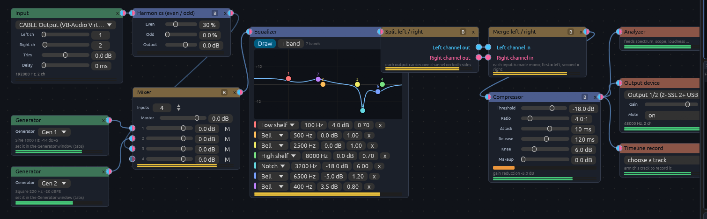

**Nodes.** Press **Space** over the canvas to search all nodes (type `eq`, `comp`, `input` ...). Drag from an output dot to an input dot to connect; an output can feed any number of inputs, which is how you split a signal to the analyser, a timeline track and an output at once. Drag an input dot away to move or drop a wire, drop a wire on empty canvas to add a node that is connected right away, right-click a wire to insert a node into it. `B` bypasses a node, `x` removes it, Delete removes the selection, Shift-drag selects several, drag the background to pan, `F` fits everything.

- **Sources:** input devices (pick any two channels as left / right, with a trim in dB and a delay in ms to line up several interfaces), generators, the timeline (master or one track)
- **Effects:** gain / polarity, equalizer (up to 12 bands, notch with adjustable depth, live curve, *Draw* mode: drag the dots in the graph, click empty space = new band, right-click a dot = remove), high- and low-pass (12 to 48 dB/oct), compressor and limiter (gain reduction meters), noise gate, delay, stereo width and balance, channel utility (mono, swap, invert)
- **Distortion and character:** distortion / harmonics in one node (soft, hard clip, asymmetric and fold-back clippers with tone and mix, or the *harmonic series* type: a series of even harmonics, 2nd / 4th / 6th ..., and / or of odd ones, 3rd / 5th / 7th ..., relative to the signal level, with "richness" deciding how far up the series reaches; files with the old separate harmonics node load as that type), fuzz (with a gate that sputters), bit crusher (bits and sample hold), jitter / wow and flutter (random or sine timing modulation, depth from 1 us to 50 ms, rates in steps of 0.1 Hz), tremolo
- **Frequency shifter:** moves every frequency by the same number of Hz (single sideband), down to hear ultrasound (a 40 kHz bat call 30 kHz lower is a 10 kHz chirp; use a 96 or 192 kHz input) or up to hear infrasound (20 Hz up by 200 Hz is 220 Hz); *Deep* quality reaches down to about 20 Hz at the price of a longer delay, and a filter keeps what would fall below 0 Hz from folding into the sound
- **Phase, space and cleaning:** phase shift / invert (polarity switch, a constant shift of every frequency, which adds about 5 ms of delay and is accurate above roughly 300 Hz, or an all-pass at a chosen frequency), convolution (loads any audio file as an impulse response: rooms, cabinets, an impulse response measured in the Impulse window; partitioned FFT, up to 6 s) and noise reduction (spectral subtraction that follows the noise floor, or learns a profile from noise alone: set *Noise* to *learn*, then to *frozen*)
- **Routing:** a mixer with 1 to 8 inputs (level and mute each), *Split left / right* (two outputs, one channel each) and *Merge left / right* (two inputs become one stereo signal). Every wire carries a stereo pair: the dot shows the left half in cyan and the right half in pink; split and merge ports show one channel
- **Timeline draw track:** *+ Track > Draw track* in the timeline: draw a curve over the timeline with the mouse; it is not in the master mix, a *Timeline out* node can pick it up as a control signal
- **Sinks:** the analyser (spectrum, scope, loudness ... read what is connected to it), output devices, timeline tracks (the *Timeline track* node: pick a track and arm it, or choose *+ New track for this node* to have the timeline add an armed track for it, then connect something to it). Connect *Timeline out* (master or a track) to a *Timeline track* node to record the master out, or a processed track, onto a new track inside the program; the delay of the loop is compensated

**Control inputs.** Every numeric value of a node (a slider, a mixer gain, the values of an equaliser band) has a small dot: drag a wire from the output of any node onto it and that signal controls the value, between a signal range and a value range you set (right-click the dot; outside the range the value stops). A generator's sawtooth on a tremolo rate, a drawing from the timeline on a filter frequency. The *Control low-pass* node (category Control) smooths such a signal first. The slider then shows the live value.

**Binding controls to inputs.** Right-click the value box of a slider or any button (also the timeline transport) to bind it to a key, a MIDI note or controller, or a joystick button or axis; the media keys work as well. A slider gets a range, a switch can be a toggle or momentary.

The **A / B** buttons in the toolbar hold two versions of the patch and switch between them with one click (*copy* makes the other one a copy of this one): the quickest way to hear what a node or a change does. The **Probe** (button or P) is a listening probe: while it is on, hover over a node, or over one of its input or output dots, and you hear the signal there on the first output node's device (the volume is next to the button, *mute outputs* silences the normal outputs meanwhile). It also works on branches that are connected to nothing. The *Routings* menu in the toolbar saves the current patch under a name and lists all saved routings to load or delete. The mouse wheel (and a pinch on a touchpad) only zooms the node window, about the pointer, also over nodes; Alt + wheel pans, the zoom button resets to 100 %. Undo and redo of the patch with Ctrl+Z and Ctrl+Y (or the buttons; a drag is one step). Right-click a line or an output dot and choose *Split here into two stereo lines* (a node with two outputs that both carry the whole signal) or *Split here into left and right channels* (not offered on lines that are mono already) to route the two channels one by one; an output device node can take a stereo pair or two single channels (its *Input* setting). Deleting an effect cuts it out of its line: what fed it is connected straight to what it fed.
Each node shows a level meter; wires brighten with the signal. A loop is refused, and an output that is captured by the input feeding it is marked as feedback. The graph is saved automatically and restored at the next start.

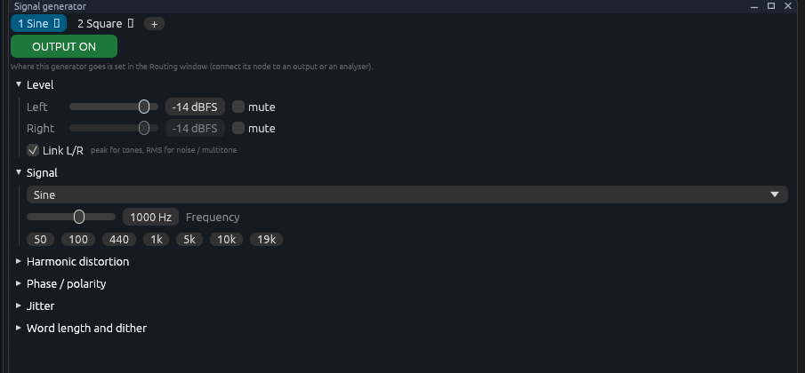

**Several generators.** With the graph on, the generator window gets tabs (`+` adds one, up to 8). Each tab is its own generator with its own wave, frequency, level and on / off, and each is a node, so a sine and a square wave can run at the same time, be mixed in the graph and go to the analyser and an output.

## Layout previews and tiling

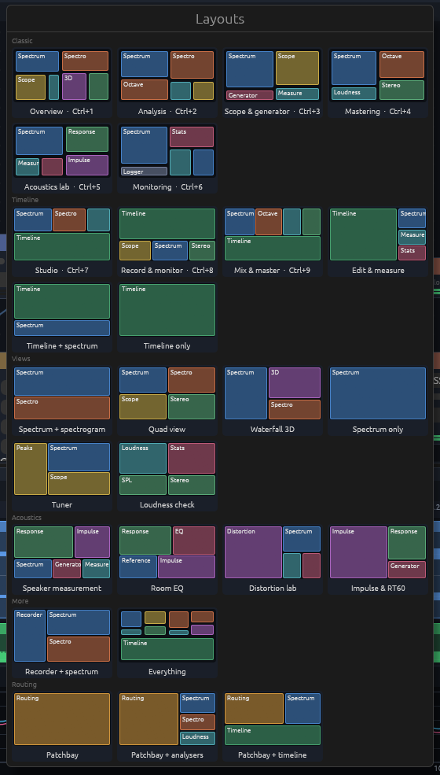

The Layouts menu shows every preset as a small picture of its arrangement (also for presets you saved). Auto tiling gives the heaviest window the most room (the routing graph first) and lays the timeline out as a full-width strip so it stays wider than tall whenever the area allows it.

## Safety buffer

*Options > Safety buffer* holds back extra audio before it is played (output devices, the monitor, timeline playback) and cushions the sources of the routing graph. It adds the same amount of delay and hides short stalls of the system, so use it when the Profiler reports an output that ran dry or the sound crackles.

## Latency

The output holds back a small cushion of sound before it plays so that short stalls of the system do not crackle. The reserve is not fixed: it starts at 20 ms (on top of one callback of the device), grows at once when a gap occurs and remembers that the smaller value was not enough. It only becomes smaller again when the queue has stayed clearly above it for a while, so no gap is provoked to find out. A source that runs a little fast, or a queue that holds more than the reserve needs, is played 0.5 % faster until the surplus is gone, so the delay does not creep up. The Profiler shows the cushion in use. The safety buffer of Options is added on top.

## Profiler

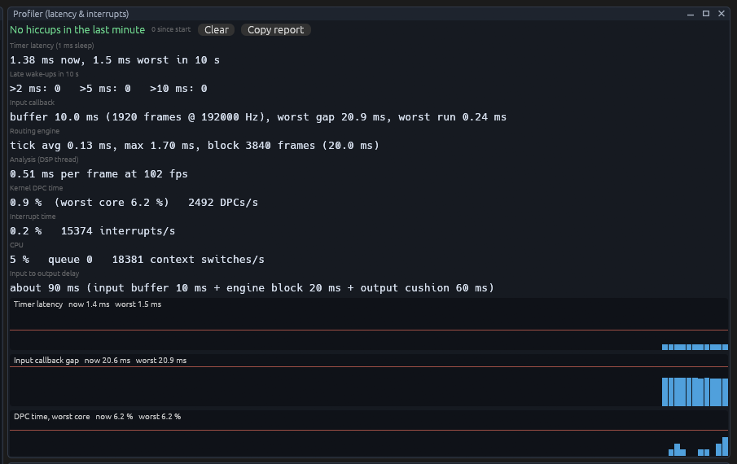

The Profiler window answers "why does it crackle on this PC": it measures how late the system wakes a thread that sleeps for 1 ms, the timing of the audio callbacks (gap, run time, buffer length), the routing engine, and the Windows performance counters for kernel DPC time (also on the busiest core), interrupt time, CPU load and context switches. Every second in which something audible happened (an overrun, an output that ran dry, a late callback, a stalled thread) is listed with the numbers of that moment and the most likely cause: a driver holding the CPU, an interrupt storm, a saturated CPU, power saving. *Copy report* puts everything on the clipboard.

## Screenshots of the new workflow

**Timeline.** Tracks with waveforms, per-track volume and pan (icons in front of the sliders), the stereo track at the top expanded into its left and right channel, and the analysis of the whole mix (levels, loudness, averaged spectrum, spectrogram) underneath.

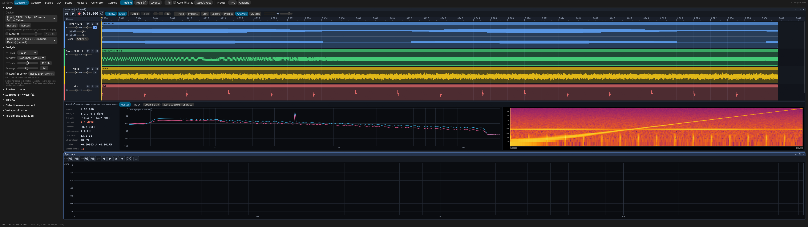

**Studio layout.** A built-in layout preset: the timeline on the bottom half with spectrum, spectrogram and loudness above it. The windows snap to each other and can be rearranged freely; there are 24 presets in the Layouts menu and Ctrl+Alt+Z / Ctrl+Alt+Y undo and redo changes of the arrangement.

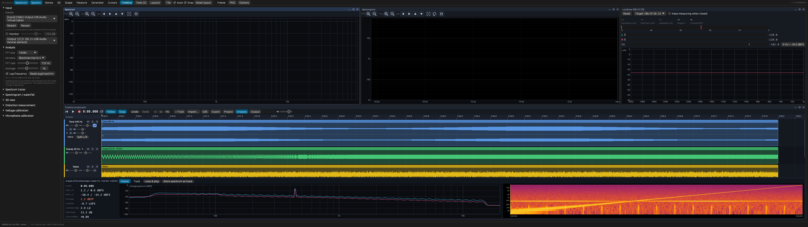

**Record and monitor.** The timeline with scope, spectrum and stereo field below. Armed tracks show their input level while the analysers keep following the live input; recording from several devices or channels at the same time is set up per track (right-click a track, *Record input*).

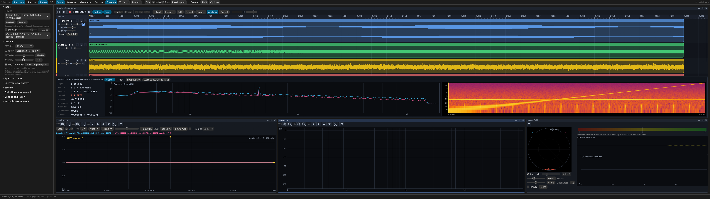

**Options.** Settings that are not needed while measuring live in one dialog (top bar, *Options*): window snapping and auto tiling, layout undo / redo, frame rate cap, readout rate and the folder the open / save dialogs start in (it is remembered between runs).

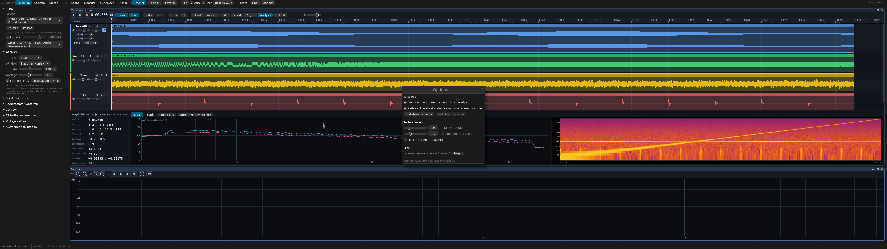

## Download

Prebuilt Windows builds are on the [Releases](../../releases) page.

## Build

Needs Rust 1.85 or newer.

```
cargo build --release
```

The executable is `target/release/visuscope.exe`. Only tested on Windows.

Settings and logs are stored in `%APPDATA%\visuscope`. Recordings and CSV logs go to `Documents\VisuScope`.

## License

[Unlicense](LICENSE), public domain.

This project was made using AI.
