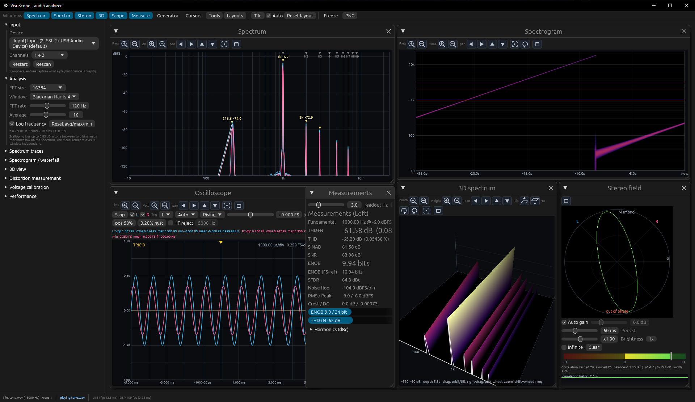
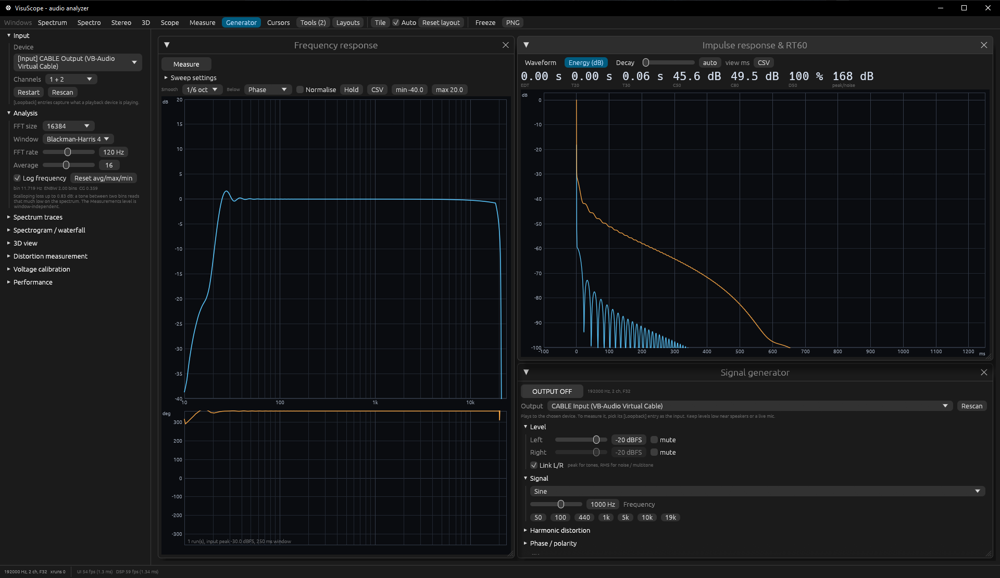
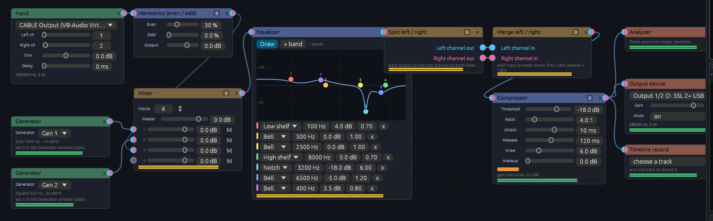
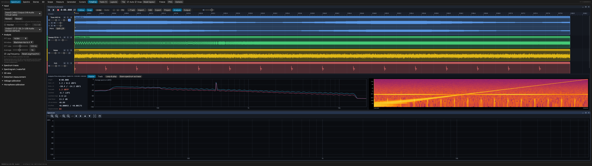
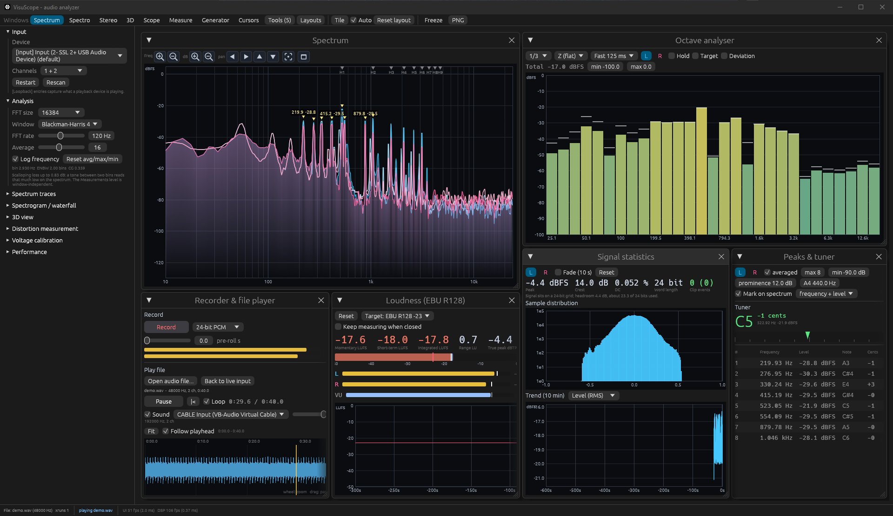

# VisuScope

Real-time audio analyzer and measurement suite for Windows. One free program for what usually takes several: spectrum and scope, distortion and frequency response measurements, speaker and room work, a multitrack recorder and a node-based audio router.

> **This is not REW (Room EQ Wizard).** It is not intended to be or replace it and has no affiliation with it.



## What it does

**See the sound, live**
- Spectrum (FFT up to 262144), spectrogram, waterfall, 3D spectrum, octave analyzer
- Oscilloscope with trigger, stereo field with goniometer and correlation
- Loudness (EBU R128), true peak, sound level meter
- Any input, any channel pair, or what the PC is playing (loopback). WASAPI and ASIO, no extra drivers or SDK

**Measure gear**
- THD, THD+N, SNR, SINAD, SFDR, ENOB, IMD, in dBFS, dBV or dBu
- Frequency response, phase, group delay and impulse response from one sweep
- Distortion against frequency and level, crosstalk, wow and flutter, multitone
- Null test: two signals lined up automatically and subtracted, hear and see what is left
- Live transfer function while music plays



**Speakers and rooms**
- Impedance and Thiele-Small parameters (DATS V3)
- Box simulation, crossover design, near-field / far-field merge
- Polar diagrams, with a turntable driven over a serial port
- RT60, clarity, STI, room modes, waterfall
- EQ design from a measurement: export for Equalizer APO, biquads or FIR, or hear it at once

**Signal generator**
- Sine, square, sweeps, multitone, IMD signals, five colours of noise
- Up to 8 generators at once

**Routing graph**
- Every input, output, generator and effect is a node; connect them with wires
- Equalizer, compressor, limiter, gate, crossover filters, convolution, noise reduction, frequency shifter and more
- A/B two patches with one click, listen in at any point with the probe
- Any value can be driven by a signal, a key, MIDI or a game controller



**Timeline**
- Record several tracks from several devices at once
- Load WAV, FLAC, MP3, Ogg, AAC, ALAC; edit without destroying the files
- Automation, markers, mixdown and stems, and every analyser can follow the playback



**Automation**
- Test sequences with pass / fail, also from the command line: `visuscope --run test.vss --report result.txt`
- Reports as HTML, exports as CSV, FRD, WAV
- Commands to an Arduino or any serial device: relays, turntables ([how it works](docs/serial.md))

**Made to be used**
- Windows that snap and tile, 24 layout presets, saved sessions
- Command palette (Ctrl+K) and an assistant that sets up a measurement from a plain sentence, offline
- Profiler that tells you why the sound crackles on this PC
- English and German, more languages by text file
- One exe, no installer, no account, no network



## Download

Prebuilt Windows builds are on the [Releases](../../releases) page.

## Build

Needs Rust 1.85 or newer.

```
cargo build --release
```

The executable is `target/release/visuscope.exe`. VisuScope is a Windows program: WASAPI, ASIO, MIDI and the serial port use Windows APIs, and CI builds and tests on Windows only. Other systems are not supported.

### Test sequences from the command line

`visuscope.exe` is a window program, so a plain `cmd` or batch line does not wait for it. Start it with `start /wait` (or `Start-Process -Wait -PassThru` in PowerShell) to get the exit code:

```
start /wait visuscope.exe --run test.vss --report result.txt
echo %ERRORLEVEL%
```

0 = pass, 1 = fail, 2 = error (script unreadable, or no audio input became ready within 30 s). Started from a console, the verdict is also printed there.

Settings and logs are stored in `%APPDATA%\visuscope`. Recordings and CSV logs go to `Documents\VisuScope`.

## License

[Unlicense](LICENSE), public domain.

This project was made using AI.
